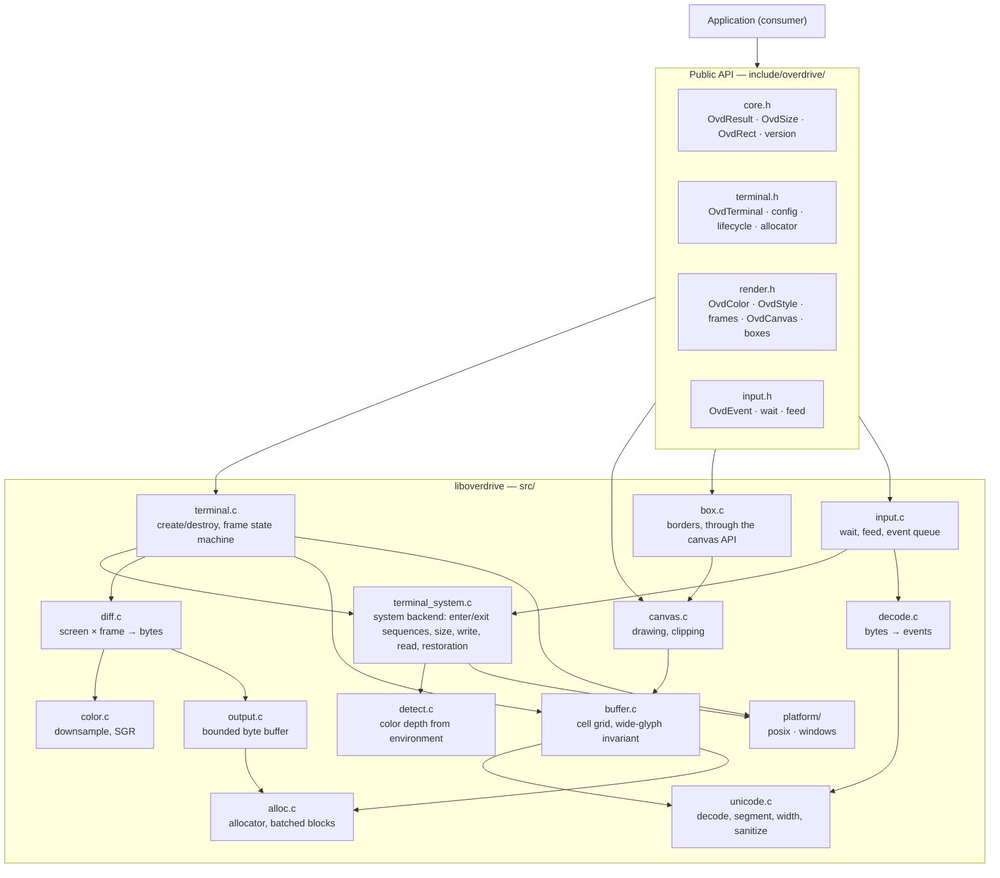
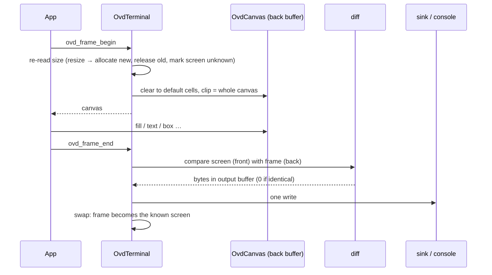

# Overdrive Architecture

> **Status: implemented (features `001-render-core` and
> `002-input-restore`), experimental 0.x.**
> This describes the code on `main`. Every number below is a measurement,
> cited with how it was taken (Art. XV). Behavior in real terminals is not
> yet observed; see [compatibility.md](compatibility.md).

## Layers

The arrows follow the `#include` graph in `src/`. An edge that is already
implied through another module is omitted.

Only `src/platform/` includes operating-system headers. Only
`include/overdrive/` is visible to consumers. The Unicode tables are
generated into the build tree by the build itself, from the vendored
UCD in `third_party/ucd/` (R5).

## Frame lifecycle

The size read in the first step works differently per backend:
- **System backend:** the size is re-read from the terminal at every
  begin (FR-014). A size that reads as 0 fails the begin with
  `OVD_ERROR_PLATFORM` (R25).
- **Headless backend:** a size set with `ovd_terminal_set_size` applies
  at the next begin.

## Rendering model

- **Immediate mode.** Each frame describes the whole screen. Nothing
  carries over implicitly (research R1).
- **Two buffers.** *Front* is what Overdrive believes is on screen;
  *back* is the frame being drawn. The next frame is a full redraw when
  the screen is unknown: the first frame, a resize, a failed write, or
  `ovd_terminal_invalidate`.
- **Cells.** A cell holds one grapheme (at most 15 UTF-8 bytes) plus its
  style. A wide grapheme owns two cells, and the second is a width-0
  continuation. Overwriting either half turns the other into a space.
- **Text is untrusted.** Control characters and invalid UTF-8 become
  U+FFFD before they reach a cell, so caller text can never become a
  control sequence.
- **Output.**
  - It uses a fixed subset of ECMA-48/xterm sequences (research R7).
  - Output never relies on autowrap: after a glyph lands in the last
    column, the next glyph is always preceded by a cursor move.
    Autowrap is also turned off for the session, as defense in depth
    (R33).
  - Each frame is one write.
- **Color.** Each cell is default, indexed, or RGB. Colors are
  downsampled at output time to the terminal's depth (R9, R10).
- **Lifecycle (system backend).** Create follows the order in R28:
  1. it requires stdout to be a terminal;
  2. it turns off input echo;
  3. it reads the size;
  4. it allocates;
  5. it writes the enter sequence.

  A failure undoes the completed steps in reverse. Destroy writes the
  exit sequence and restores the modes it read (R26). With input on,
  create also puts stdin in raw mode, and with `restore_on_exit` it arms
  the restoration record described below; destroy undoes both.

## Input

Feature 002, research R102 to R111.

- **Decoder (`decode.c`).** It decodes bytes from the terminal, which
  are untrusted, in two layers (R104):
  1. ECMA-48 syntax: C0 controls, `ESC` sequences, SS3, and CSI with
     bounded parameters;
  2. a dispatch table that names keys, mouse reports, paste markers, and
     focus.

  A sequence the table does not name is discarded, and no input byte is
  ever written to the terminal (FR-019). The decoder keeps the partial
  sequence between calls, reads no clock (time is an argument), and
  allocates nothing.
- **Escape delay.** A lone `ESC` becomes the Escape key after
  `escape_delay_ms`, 50 ms by default (R109).
- **Wait (`input.c`).** `ovd_input_wait` returns one event, or reports a
  timeout as success (R102). An event already decoded is returned
  without blocking. The system backend blocks on stdin; on POSIX, a
  `SIGWINCH` handler reports resizes. The headless backend reads the
  bytes given to `ovd_input_feed`, on a virtual clock.
- **Allocation.** Input's buffers are allocated at create only. Reading
  input makes no allocator calls afterwards (SC-004; see
  Measurements).

## Abnormal-exit restoration

Feature 002, research R112, R113, and R121. With `restore_on_exit` on
(the default), a system terminal restores the terminal when the process
ends through a signal, a crash, or a closed console, as destroy would
restore it.

- **Process-wide state.** The handlers, and the record they read, are
  process-wide. This is the one exception to 001 FR-002 (FR-036), and
  `terminal.h` documents it at the create options. Only one system
  terminal owns the record. Headless terminals install no handler and
  keep no process-wide state.
- **The record.** It holds the modes to restore and the exit sequence,
  built at create. Its atomic state goes `IDLE` → `ARMED` → `CLAIMED` →
  `DONE`, so restoration runs at most once, whichever of destroy, a
  signal, or a crash comes first (FR-033).
- **POSIX.** One `sigaction` handler covers `SIGHUP`, `SIGINT`,
  `SIGQUIT`, `SIGTERM`, `SIGABRT`, `SIGSEGV`, `SIGBUS`, `SIGFPE`, and
  `SIGILL`. It uses async-signal-safe calls only.
  - A signal that was ignored before create stays ignored.
  - For a termination signal the application already handles, the
    application keeps it: Overdrive calls the application's handler and
    restores nothing.
  - Otherwise, the handler restores once. Then it calls the application's
    handler, if there is one, and returns. If there is none, it re-raises
    the signal under the default action, so the exit status stays the
    same as without Overdrive.
- **Windows (R113, option B).** Restoration runs from three handlers:
  - a console control handler, for Ctrl+C (only while input is off),
    Ctrl+Break, and closing the console;
  - an unhandled-exception filter;
  - a `SIGABRT` handler.

  The filter and the `SIGABRT` handler chain to what they replaced. The
  console handler returns without handling the event, so the next
  console handler still runs. The C runtime's own console handler
  decides whether the application has claimed Ctrl+C and Ctrl+Break.
- **Destroy** puts back each handler that is still Overdrive's. A
  handler the application installed after create stays in place.
- **Not covered (FR-034).**
  - Uncatchable ends: `SIGKILL` and power loss.
  - A normal exit without destroy: `exit`, or returning from `main`.
  - Modes another program changed.
  - While create or destroy runs: a signal delivered to another thread,
    or a synchronous fault (`SIGSEGV`, `SIGBUS`, `SIGFPE`, `SIGILL`) on
    the thread running it.
  - On macOS, an application handler installed with `SA_RESETHAND` that
    returns from a real fault or re-raises a termination signal, because
    the platform does not report the flag (R121).
  - On Windows, logoff and shutdown, and a console handler the
    application registered directly before create.

  The spec gives the full list, and `terminal.h` repeats it at
  `restore_on_exit`.

## Ownership

| Object | Owner | Lifetime |
|---|---|---|
| `OvdTerminal` | caller (`create`/`destroy`) | until destroy |
| `OvdCanvas` | terminal | create → destroy; one per terminal, open only from `frame_begin` to `frame_end`/`abandon` (research R23) |
| cell buffers, output buffer | terminal | allocated at create and on resize only; output sized to the worst-case frame (research R30) |
| `OvdCellView.text` | canvas | until next draw or frame end |
| sink, allocator callbacks | caller | must outlive the terminal |

Allocation happens only in `ovd_terminal_create` and in an
`ovd_frame_begin` whose size differs from the current buffers. A resize
allocates every new buffer before releasing any old one (R31), so a
refused allocation changes nothing. `test_steady_state` checks the
following through the public API, with a counting allocator:
- 0 allocator calls over the first frame and the 100 frames after it;
- 0 allocator calls over the 100 frames after a resizing frame;
- at three sizes, four color depths, and with synchronized output on
  and off (R47).

## Measurements

These are from `bench/render_benchmark.c`, research R47. They were
measured on 2026-11-04 with these steps:
1. `cmake --preset bench`;
2. `cmake --build --preset bench`;
3. the `render_benchmark` program, run with no argument (1000 frames per
   scenario).

The machine was an Apple M3 Pro (11 cores, 18 GiB, Darwin 27.2.0). The
build was Release with AppleClang 21.0.0 (`-O3 -DNDEBUG`). The clock was
`TIME_UTC`, with a 1 µs step.

What is timed is `ovd_frame_end` alone, in µs, on a headless truecolor
terminal. The sink only counts bytes, so no number here includes a real
terminal's I/O.

| Scenario | Size | Bytes/frame | Median | p99 |
|---|---|---|---|---|
| Full redraw | 200×60 | 16701 | 271 | 309 |
| One-cell change | 200×60 | 47 | 51 | 64 |
| Scrolling region | 200×60 | 5806–5866 | 128 | 155 |
| No change | 200×60 | 0 | 51 | 64 |
| SC-003 worst cell | 999×999 | 54 | 3919 | 5096 |

SC-003 requires a one-cell change to cost at most 64 bytes. Its worst
case, the bottom-right cell of a 999×999 terminal with RGB colors and a
4-byte glyph, measured 54. No SC-008 time target is set yet; this is the
first measurement.

### Input and restoration

These are counts that the tests print, not times. They come from the
`debug` preset, run on 2026-11-05 on the same machine.

| Test | What it prints |
|---|---|
| `test_decode_fuzz` | 10⁷ bytes in all: 5000118 with a paste text capacity of 8 bytes and 5000091 with 256, with every decoder invariant holding after every call (SC-002) |
| `test_steady_state` | 0 allocator calls over 10000 headless feed and wait calls with input on (SC-004) |
| `test_restore_pty` | 8 runs of create and destroy in a loop, each ended by `SIGTERM` after a seeded delay of 3 to 138 ms. They made 13 to 1597 enters each, and each run had exactly as many exits. The counts depend on the machine's speed. |

No input latency is measured. The timing case of `test_system_pty`
checks bounds (SC-005), and prints numbers only when it fails:
- a byte written during a wait arrives within 1 s;
- a lone `ESC` resolves no sooner than the escape delay, and within 1 s
  after it.

## Not in this architecture (yet)

`OVD-IDENTITY-001` §4 names Input, Layout, Motion, and Widgets. Input
is implemented, with abnormal-exit restoration, as feature 002
([`specs/002-input-restore/`](../specs/002-input-restore/)), because the
first consumer needs it. Layout, Motion, and Widgets have no present
requirement yet (Art. VII).

The decoder reads no inline image protocols (kitty graphics, sixel).
Its dispatch table can gain such entries when a feature specifies them.
