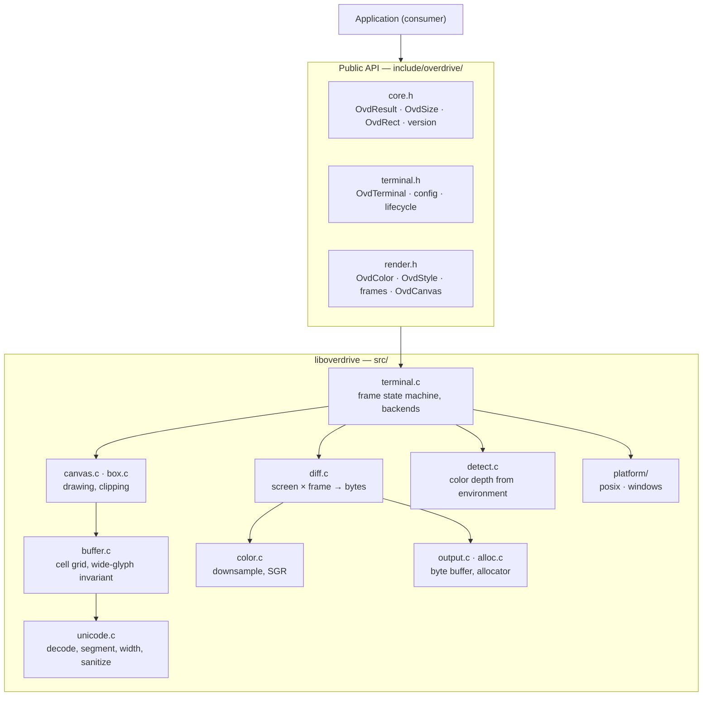
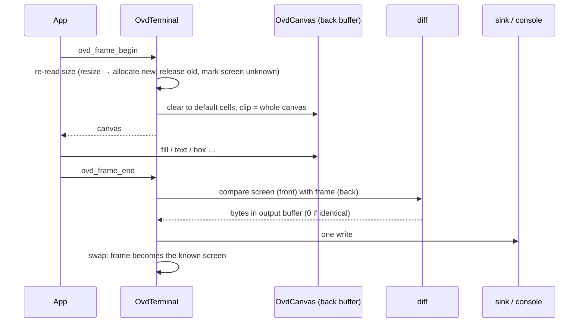

# Overdrive Architecture

> **Status: planned.** This describes the design of feature
> `001-render-core`. Nothing here is implemented yet (Art. XV). When the
> implementation lands, this file is updated to describe what exists, with
> measurements.

## Layers

Only `src/platform/` includes operating-system headers. Only
`include/overdrive/` is visible to consumers.

## Frame lifecycle

## Rendering model

- **Immediate mode.** Each frame describes the whole screen; nothing
  carries over implicitly (research R1).
- **Two buffers.** *Front* is what Overdrive believes is on screen; *back*
  is the frame being drawn. When the screen is unknown (first frame,
  resize, failed write, invalidate), the next frame is a full redraw.
- **Cells.** One grapheme (≤ 15 UTF-8 bytes) plus style. A wide grapheme
  owns two cells; the second is a width-0 continuation. Breaking either
  half blanks the other.
- **Text is untrusted.** Control characters and invalid UTF-8 become
  U+FFFD before they reach a cell, so caller text can never become a
  control sequence.
- **Output.** A fixed subset of ECMA-48/xterm sequences (research R7),
  never relying on autowrap (it is also off for the session, R33), one
  write per frame.
- **Color.** Default, indexed, or RGB per cell; downsampled at output time
  to the terminal's depth (R9, R10).

## Ownership

| Object | Owner | Lifetime |
|---|---|---|
| `OvdTerminal` | caller (`create`/`destroy`) | until destroy |
| `OvdCanvas` | terminal | create → destroy; one per terminal, open only from `frame_begin` to `frame_end`/`abandon` (research R23) |
| cell buffers, output buffer | terminal | allocated at create and on resize only; output sized to the worst-case frame (research R30) |
| `OvdCellView.text` | canvas | until next draw or frame end |
| sink, allocator callbacks | caller | must outlive the terminal |

## Not in this architecture (yet)

Input, Layout, Motion, and Widgets are named in `OVD-IDENTITY-001` §4 but
have no present requirement in feature 001 (Art. VII). Input is expected
to be feature 002 because the first consumer needs it.
