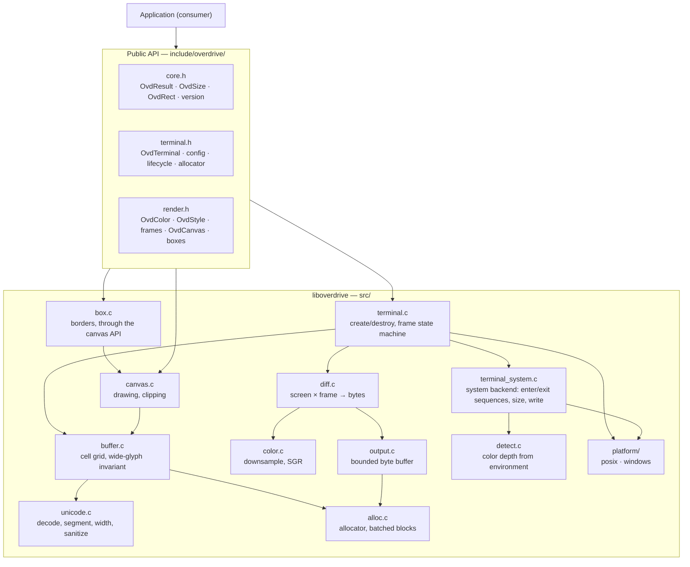
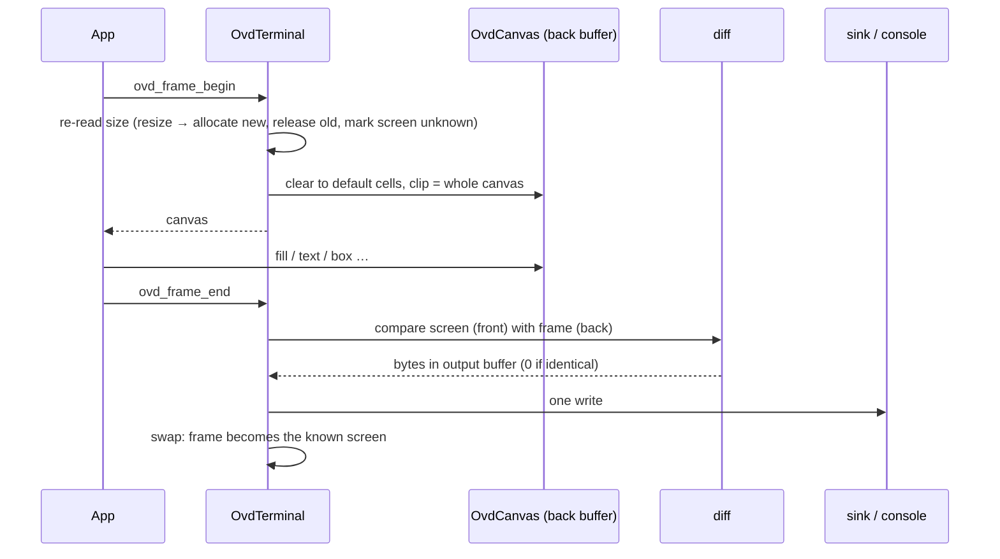

# Overdrive Architecture

> **Status: implemented (feature `001-render-core`), experimental 0.x.**
> This describes the code on `main`. Every number below is a measurement,
> cited with how it was taken (Art. XV). Behavior in real terminals is not
> yet observed; see [compatibility.md](compatibility.md).

## Layers

The arrows follow the `#include` graph in `src/`. An edge that is already
implied through another module is omitted.

Only `src/platform/` includes operating-system headers. Only
`include/overdrive/` is visible to consumers. The Unicode tables are
generated into the build tree by the build itself, from the vendored
UCD in `third_party/ucd/` (R5).

## Frame lifecycle

The size read in the first step works differently per backend:
- **System backend:** the size is re-read from the terminal at every
  begin (FR-014). A size that reads as 0 fails the begin with
  `OVD_ERROR_PLATFORM` (R25).
- **Headless backend:** a size set with `ovd_terminal_set_size` applies
  at the next begin.

## Rendering model

- **Immediate mode.** Each frame describes the whole screen. Nothing
  carries over implicitly (research R1).
- **Two buffers.** *Front* is what Overdrive believes is on screen;
  *back* is the frame being drawn. The next frame is a full redraw when
  the screen is unknown: the first frame, a resize, a failed write, or
  `ovd_terminal_invalidate`.
- **Cells.** A cell holds one grapheme (at most 15 UTF-8 bytes) plus its
  style. A wide grapheme owns two cells, and the second is a width-0
  continuation. Overwriting either half turns the other into a space.
- **Text is untrusted.** Control characters and invalid UTF-8 become
  U+FFFD before they reach a cell, so caller text can never become a
  control sequence.
- **Output.**
  - It uses a fixed subset of ECMA-48/xterm sequences (research R7).
  - Output never relies on autowrap: after a glyph lands in the last
    column, the next glyph is always preceded by a cursor move.
    Autowrap is also turned off for the session, as defense in depth
    (R33).
  - Each frame is one write.
- **Color.** Each cell is default, indexed, or RGB. Colors are
  downsampled at output time to the terminal's depth (R9, R10).
- **Lifecycle (system backend).** Create follows the order in R28:
  1. it requires stdout to be a terminal;
  2. it turns off input echo;
  3. it reads the size;
  4. it allocates;
  5. it writes the enter sequence.

  A failure undoes the completed steps in reverse. Destroy writes the
  exit sequence and restores the modes it read (R26).

## Ownership

| Object | Owner | Lifetime |
|---|---|---|
| `OvdTerminal` | caller (`create`/`destroy`) | until destroy |
| `OvdCanvas` | terminal | create → destroy; one per terminal, open only from `frame_begin` to `frame_end`/`abandon` (research R23) |
| cell buffers, output buffer | terminal | allocated at create and on resize only; output sized to the worst-case frame (research R30) |
| `OvdCellView.text` | canvas | until next draw or frame end |
| sink, allocator callbacks | caller | must outlive the terminal |

Allocation happens only in `ovd_terminal_create` and in an
`ovd_frame_begin` whose size differs from the current buffers. A resize
allocates every new buffer before releasing any old one (R31), so a
refused allocation changes nothing. `test_steady_state` checks the
following through the public API, with a counting allocator:
- 0 allocator calls over the first frame and the 100 frames after it;
- 0 allocator calls over the 100 frames after a resizing frame;
- at three sizes, four color depths, and with synchronized output on
  and off (R47).

## Measurements

These are from `bench/render_benchmark.c`, research R47. They were
measured on 2026-11-04 with these steps:
1. `cmake --preset bench`;
2. `cmake --build --preset bench`;
3. the `render_benchmark` program, run with no argument (1000 frames per
   scenario).

The machine was an Apple M3 Pro (11 cores, 18 GiB, Darwin 27.2.0). The
build was Release with AppleClang 21.0.0 (`-O3 -DNDEBUG`). The clock was
`TIME_UTC`, with a 1 µs step.

What is timed is `ovd_frame_end` alone, in µs, on a headless truecolor
terminal. The sink only counts bytes, so no number here includes a real
terminal's I/O.

| Scenario | Size | Bytes/frame | Median | p99 |
|---|---|---|---|---|
| Full redraw | 200×60 | 16701 | 271 | 309 |
| One-cell change | 200×60 | 47 | 51 | 64 |
| Scrolling region | 200×60 | 5806–5866 | 128 | 155 |
| No change | 200×60 | 0 | 51 | 64 |
| SC-003 worst cell | 999×999 | 54 | 3919 | 5096 |

SC-003 requires a one-cell change to cost at most 64 bytes. Its worst
case, the bottom-right cell of a 999×999 terminal with RGB colors and a
4-byte glyph, measured 54. No SC-008 time target is set yet; this is the
first measurement.

## Not in this architecture (yet)

`OVD-IDENTITY-001` §4 names Input, Layout, Motion, and Widgets, but
feature 001 has no present requirement for them (Art. VII). Input is
expected to be feature 002 because the first consumer needs it.
