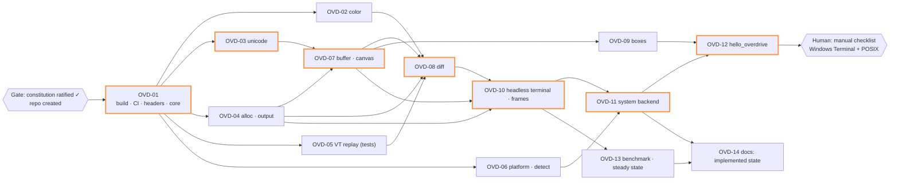

# Workstreams: 001-render-core

The machine-readable source of truth is
[`specs/001-render-core/workgraph.json`](../../specs/001-render-core/workgraph.json);
this page is its human view. Task detail is in
[`tasks.md`](../../specs/001-render-core/tasks.md).

## Dependency graph

Orange border = critical path.

## Parallel lanes

| Wave | Issues in flight | Max agents | Starts when |
|---|---|---|---|
| 0 | OVD-01 | 1 | gate G0 |
| 1 | OVD-02, 03, 04, 05, 06 | 5 | OVD-01 merged |
| 2 | OVD-07 (+ any wave-1 stragglers) | 1–3 | OVD-03 and OVD-04 merged |
| 3 | OVD-08, OVD-09 | 2 | OVD-07 merged (+ 02, 05 for 08) |
| 4 | OVD-10, then OVD-11 ∥ OVD-13 | 2 | OVD-08 merged |
| 5 | OVD-12, OVD-14 | 2 | OVD-11 (+ 09, 13) merged |

## File ownership

Each issue owns a disjoint set of paths (checked: no overlap in
`workgraph.json`). Two files are **shared append-only**:
`CMakeLists.txt` (source list) and `tests/CMakeLists.txt` (one
`ovd_add_test` line per test). Agents only append their own lines and
resolve conflicts by rebasing on `main`. `include/overdrive/` is frozen
after OVD-01: changing it takes its own contract-change issue, labeled
`assumption` for the owner's after-the-fact review.

## Human gates

Agents merge through the Art. XVI gate
([swarm protocol](../process/swarm.md#merge-authority)). A human is
needed only for:

1. **Manual validation** — OVD-11/OVD-12 in Windows Terminal and one POSIX
   terminal. Agents cannot observe a real terminal; they merge with the
   gap reported as UNVERIFIED and a `needs-human` issue tracks the check.
2. **License and publication** — before any release; not on this graph.

## Consumer integration (not in this graph)

Adopting Overdrive in the task-tracking application is that repository's
decision, made through its own issues and approvals, after Overdrive's
input feature (002) exists. Nothing in this graph touches that
repository.
